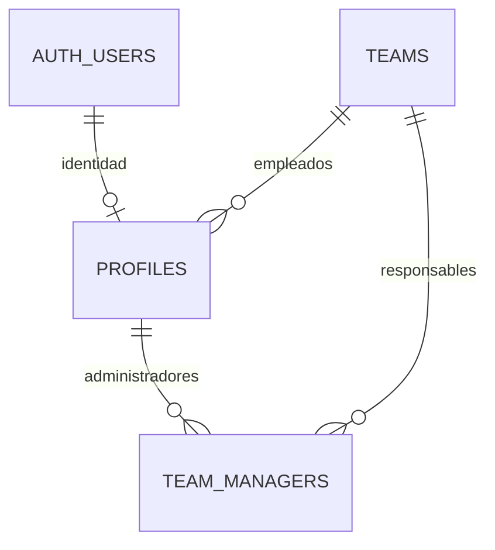

# Arquitectura de la fase 1

Implementación propia para una empresa, sobre la base existente Next.js 16.4, React 19, TypeScript, Tailwind 4 y shadcn/ui con Base UI. No depende de EmotionTracker ni incorpora organizaciones, pagos o multi-tenancy.

## Organización

```text
src/
  app/                         Rutas, layouts y composición de pantallas
    (auth)/                    Login, recuperación y cambio de contraseña
    auth/                      Confirmación de recuperación y callback PKCE
    (protected)/
      company/                 Dashboard de empresa
      team/                    Dashboard de responsable
      employee/                Dashboard privado del empleado
      admin/                   Gestión compartida, limitada por rol
  modules/
    auth/                      Sesión, roles, validación y acciones Auth
    administration/            Consultas, acciones y formulario de usuarios
    shared/                    Contrato de respuesta de formularios
  lib/supabase/                Clientes SSR, navegador, Auth Admin y tipos
  components/forms/            Formularios y controles reutilizables
  components/ui/               Componentes shadcn de la base
  proxy.ts                     Refresco de sesión, cookies y no-store
supabase/
  migrations/                  Modelo, permisos, funciones y RLS versionados
  templates/                   Correo de recuperación
scripts/                       Inicialización, demo y generación de tipos
tests/                         Autorización en PostgreSQL embebido y validación
```

Las rutas componen módulos de dominio; no contienen lógica de permisos ni acceso privilegiado. Las lecturas y mutaciones del directorio usan el cliente SSR con la sesión del actor. La clave secreta se utiliza únicamente para crear o compensar cuentas Auth, y en scripts explícitos de instalación.

## Modelo



- `auth.users`: credenciales y sesión gestionadas por Supabase.
- `profiles`: identidad administrativa, nombre, correo de referencia, rol, estado y equipo del empleado. Sin campos emocionales. La fila no se crea automáticamente al registrarse en Auth.
- `teams`: equipos de la empresa, con nombres únicos sin distinguir mayúsculas.
- `team_managers`: relación entre equipos y responsables; un responsable puede gestionar varios equipos y un equipo tener varios responsables.
- `app_private.admin_audit`: trazabilidad mínima de mutaciones administrativas; no contiene contraseñas, tokens, texto de diarios ni datos emocionales.

Una restricción exige un equipo para cada empleado, incluso desactivado. Los administradores tienen `team_id = null`; sus responsabilidades se expresan en `team_managers`. Las claves foráneas relevantes están indexadas. No hay borrado de empleados: se desactivan para preservar identidad e historial futuro.

## Permisos

| Capacidad | Empresa | Equipo | Empleado |
| --- | --- | --- | --- |
| Leer directorio | Todos | Propio perfil y empleados de sus equipos | Propio perfil |
| Leer equipos | Todos | Asignados | Propio equipo |
| Crear/modificar equipos | Sí | No | No |
| Crear/modificar usuarios y roles | Todos | Solo empleados de sus equipos; no cambia roles | No |
| Trasladar empleados | Cualquier equipo | Debe gestionar origen y destino | No |
| Desactivar/reactivar usuarios | Sí, salvo sí mismo | Empleados de sus equipos | No |
| Asignar responsables | Sí | No | No |
| Leer diarios ajenos | Nunca | Nunca | Nunca |
| Estadísticas futuras | Agregados de empresa | Agregados de sus equipos | Propias |

La administración de equipo no crea equipos ni reasigna responsables: estas operaciones modifican el alcance de autorización y pertenecen a la administración de empresa.

Cada página, consulta y Server Action comprueba la sesión y el rol en el servidor. RLS protege también llamadas directas a la API. No se usa `user_metadata` para autorizar y los roles no dependen de información desactualizada en JWT: las políticas consultan la fila activa del perfil.

No hay permisos `INSERT`, `UPDATE` o `DELETE` de las tablas para `authenticated`. Las escrituras se realizan mediante RPC públicas `SECURITY INVOKER` que delegan en implementaciones `SECURITY DEFINER` del esquema no expuesto `app_private`. Estas últimas usan `search_path = ''`, nombres cualificados, permisos de ejecución explícitos y validan al actor y ambos equipos. Las funciones públicas no se pueden ejecutar como `anon`. `bootstrap_admin` solo es ejecutable con `service_role`.

Las mutaciones administrativas comparten un bloqueo de transacción antes de comprobar permisos. Es una decisión simple para esta demo: evita carreras entre una desactivación y una asignación, y protege frente a administradores que intenten desactivarse mutuamente a la vez. No se permite desactivar ni cambiar el propio rol, por lo que se conserva al menos un administrador activo mediante las operaciones de la aplicación. Una futura instalación grande puede sustituir el bloqueo global por bloqueos de filas con un orden definido.

Al desactivar a un responsable se retiran sus asignaciones. Reactivarlo requiere asignarlas de nuevo. La autorización deja de conceder acceso en la siguiente solicitud, aunque Auth todavía reconozca el JWT; no se afirma que desactivar un perfil invalide criptográficamente ese JWT. Los datos ya descargados no pueden retirarse del navegador.

## Sesión y recuperación

Se usan `@supabase/ssr`, cookies, `getClaims()` y `proxy.ts`, siguiendo el [patrón SSR actual de Supabase](https://supabase.com/docs/guides/auth/server-side/creating-a-client?framework=nextjs). `getUser()` se añade antes del cambio de contraseña. No se confía en `getSession()` para autorizar.

Se deshabilita Cache Components en esta fase. La información de sesión y directorio se resuelve por solicitud y las respuestas del proxy usan `private, no-store`. `React.cache()` solo deduplica la consulta de sesión dentro del render actual. No se debe configurar caché compartida/CDN para estas páginas ni sus cookies.

No existe ruta ni acción de registro. El registro público también debe estar deshabilitado en Auth: `config.toml` lo hace en local; la configuración alojada debe aplicarse en el proyecto de Supabase antes de habilitar la demo.

Las cuentas creadas desde administración reciben una contraseña aleatoria no mostrada ni enviada. El usuario debe solicitar recuperación para establecer su contraseña. La respuesta de recuperación no revela si el correo existe. El enlace `token_hash` es de un solo uso y funciona desde otro navegador; se mantiene un callback PKCE para el flujo estándar en el mismo navegador. No se admite un parámetro de redirección arbitraria. Tras cambiar la contraseña se solicita cierre global y se vuelve al login; los JWT ya emitidos pueden sobrevivir hasta su expiración según Supabase.

El correo de acceso no se edita desde administración: se evita sustituir credenciales o tomar una cuenta mediante un cambio administrativo. Se permite modificar nombre, equipo, rol (empresa) y estado. Si en una fase posterior se habilita cambio de correo, deberá incluir confirmación y sincronización explícita entre Auth y el directorio.

Auth y PostgreSQL no comparten una transacción HTTP. Si falla la creación del perfil se intenta eliminar la cuenta Auth recién creada. Una FK `RESTRICT` impide borrar una cuenta cuyo perfil ya se confirmó si hubo un fallo de transporte. Si falla la compensación se registra únicamente el UUID y el código; debe reconciliarlo un operador. Una cuenta Auth sin perfil no tiene acceso a la aplicación ni al directorio.

## Separación del diario y los agregados futuros

Los esquemas `journal_private` y `reporting` se reservan sin tablas ni funciones de estadísticas. No están expuestos en la Data API, y los roles de aplicación no tienen uso sobre ellos. Esta fase no guarda emociones ni implementa estadísticas, rachas o IA.

En la fase del diario, su módulo y políticas deberán permitir solo lectura/escritura del propietario activo, **sin excepción por rol administrativo**. La aplicación administrativa no importará ese módulo ni usará el cliente privilegiado para consultarlo.

Los agregados futuros se expondrán mediante una API específica de `reporting` que valide el alcance actual, aplique un umbral mínimo de participantes y devuelva únicamente medidas anónimas; nunca UUID de empleados, textos individuales o series que permitan reconstruir entradas. Habrá que decidir tamaño mínimo, periodos y protección contra diferencias entre consultas antes de implementar estadísticas. Una vista pública con permisos elevados no sería una separación suficiente.

La restricción aplica a los administradores de la aplicación. Los operadores con credenciales de infraestructura/SQL de Supabase conservan privilegios técnicos: no deben entregarse esas claves a usuarios de los tres roles.

## Continuación y referencias

Para ampliar una funcionalidad: añadir módulo, migración, tipos y pruebas de autorización; después conectar las rutas. Revisar siempre las guías de la versión instalada en `node_modules/next/dist/docs/`.

- [Seguridad de filas en Supabase](https://supabase.com/docs/guides/database/postgres/row-level-security)
- [Recuperación por contraseña](https://supabase.com/docs/guides/auth/passwords)
- [Guías locales de Next.js: autenticación y formularios](../node_modules/next/dist/docs/01-app/02-guides/authentication.md)
